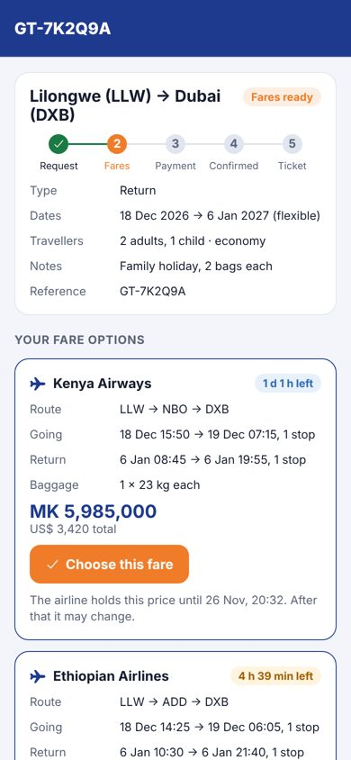
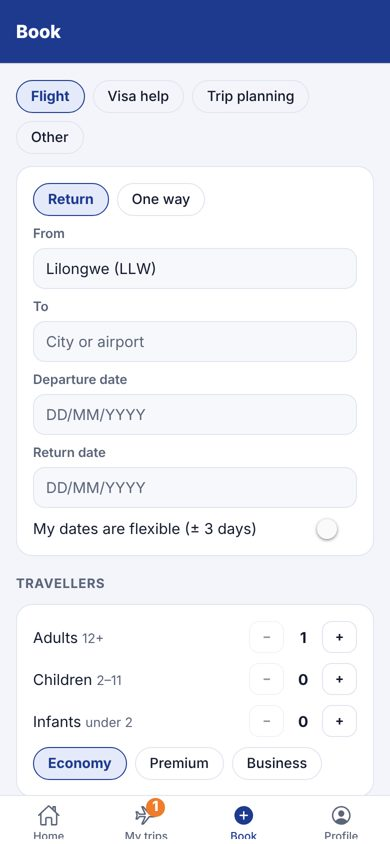
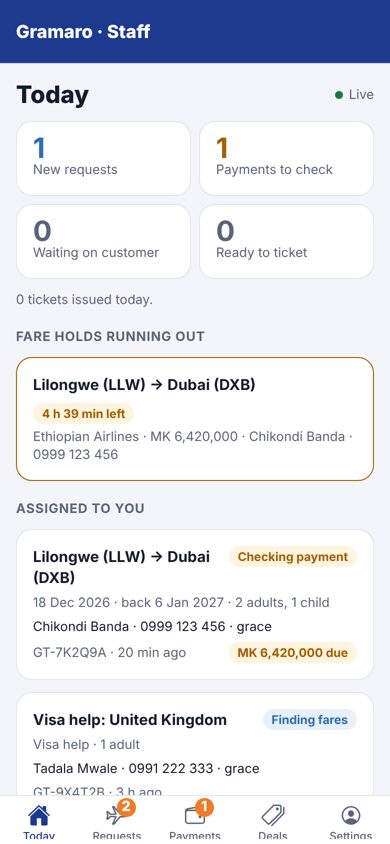
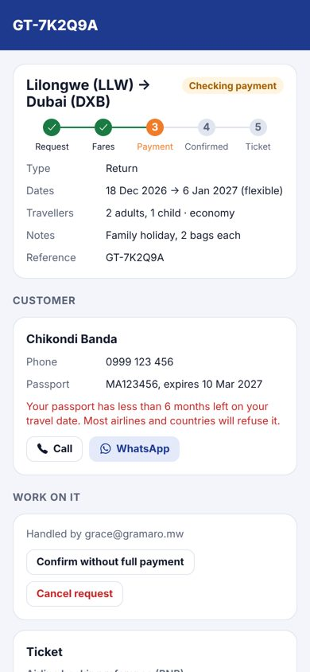
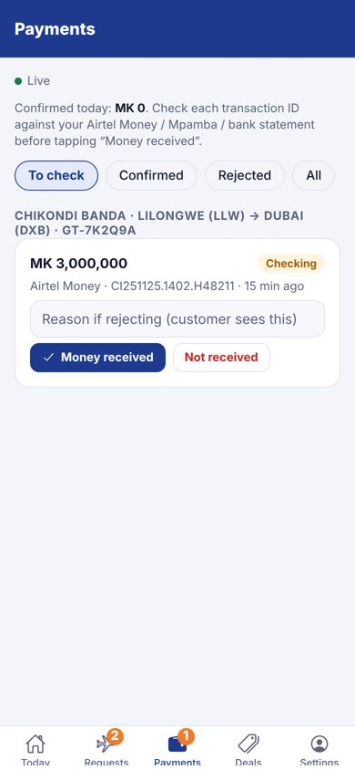

# Gramaro Travel

A real-time mobile app for **Gramaro Travel Agency** (Zomba, Malawi): customers request flights, visas and trip plans, get fare options live with hold countdowns, pay by Airtel Money / TNM Mpamba / bank / cash (instalments allowed) and receive their ticket in the app. Staff work all requests from one shared inbox.

- **Why and how:** [RESEARCH.md](RESEARCH.md) covers the agency's workflow, the problems the app solves, and sources.
- **Set it up:** [SETUP.md](SETUP.md) takes about 15 minutes, once.
- **Download (Android):** https://github.com/Nlerealest/Nelson/releases/download/gramaro-latest/gramaro.apk (after the first build).

| Customer | | | Staff | | |
| --- | --- | --- | --- | --- | --- |
|  |  |  |  |  |  |

## How it fits together

```
Customer app ─┐                         ┌─ Staff app (same APK, staff emails)
              ├──  Supabase  (Postgres + Auth + Realtime)  ──┤
              │    row rules: customers see only their own trips
              │    triggers: status, payments, timeline
              └── live updates within ~1 s, no refresh ──────┘
```

Trip flow: `new → quoting → quoted → accepted → paid → confirmed → ticketed → completed` (or `cancelled`).

## Code

- `src/app/` holds the screens (Expo Router). `(tabs)/` has different tabs for customers and staff. `request/[id].js` is the live trip screen.
- `src/data.js` loads everything once, then keeps it live through one Realtime channel.
- `src/format.js` has money, dates, fare-hold and passport checks (tested in `tests/`).
- `supabase/schema.sql` holds the tables, security rules, triggers and customer actions. Safe to run again.

```bash
npm install
npx expo start          # needs EXPO_PUBLIC_SUPABASE_URL / EXPO_PUBLIC_SUPABASE_ANON_KEY, or enter them in the app
npm test && npx expo lint
```
